<div align="center">



<br/>

[](LICENSE)
[]()
[]()
[]()
[]()

<p align="center">
  <b>Asistente de sistema y control remoto por herramientas ultra-ligero para macOS y Windows.</b><br/>
  <i>Entrenado para español natural. 100% Offline. Publicado bajo licencia Apache-2.0.</i>
</p>

---



</div>

## 🚀 Instalación en 1 Línea (Zero-Config)

### 🪟 En Windows (PowerShell / Laptop de bajos recursos)
Abre PowerShell y pega este comando de instalación automática:
```powershell
powershell -ExecutionPolicy Bypass -Command "irm https://raw.githubusercontent.com/Wagustin/omnicontrolpc/main/install.ps1 | iex"
```
> **¿Sin consola?** Descarga **`install.bat`** y haz **doble clic**. Configura el entorno, descarga el motor y crea un acceso directo en el Escritorio. No requiere administrador.

<details>
<summary><b>Opciones del instalador (Windows)</b></summary>

```powershell
# Instalación local junto al repositorio clonado
.\install.bat

# Copia por usuario en %LOCALAPPDATA%\Programs\OmniControlPC
.\install.bat -UserInstall

# Motor descargado previamente (instalación sin conexión)
.\install.bat -EngineArchive "D:\offline\needle-windows-x86_64.zip"

# Forzar actualización de Python, paquete y motor
.\install.bat -Force -Upgrade

# Ver todas las opciones
Get-Help .\install.ps1 -Detailed
```

El instalador espera un asset de release llamado `needle-windows-x86_64.zip` (y su `.sha256` si está disponible). Si el asset usa otro nombre, pasa `-EngineUrl <url>` o `-EngineArchive <ruta>`. El estado generado queda en `.omnicontrol\` y el log en `.omnicontrol\install.log`. Para ejecuciones desatendidas, define `OMNICONTROL_NO_PAUSE=1`.
</details>

---

### 🍎 En macOS (Apple Silicon M1/M2/M3/M4)
Abre Terminal y ejecuta:
```bash
curl -fsSL https://raw.githubusercontent.com/Wagustin/omnicontrolpc/main/install.sh | bash
```
> Configura el comando global `omnicontrol` y el alias ultra-rápido `oc` en tu terminal, además de compilar `OmniControl.app` para invocarlo desde Spotlight (`Cmd + Espacio`) o atajos de teclado globales.

### Modos de uso

#### 🎙️ 1. Modo Asistente de Voz (Push-to-Talk + Whisper Local)
Controla tu equipo hablándole directamente en español, 100% privado y sin enviar audio a servidores externos:
```bash
# Iniciar modo de voz asistente
oc --voice
# o también:
python jarvis_client.py --voice
```
* **Presiona ENTER para hablar** (o mantén pulsado en modo Push-to-Talk).
* **Whisper Local (int8)** transcribe en tiempo real (< 150ms).
* **Chimes de audio:** Emite un sutil tono de confirmación sonora al completar la acción o alertar si hubo un error.

#### ⌨️ 2. Desde el teclado y Terminal
* **Alias directo:**
  ```bash
  oc "sube el volumen al 50%"
  oc "silencia el audio"
  oc "busca pdf en Descargas"
  ```
* **Consola interactiva (REPL):**
  ```bash
  oc
  # omnicontrol > abre el campus virtual
  # omnicontrol > voice   (activa el micro)
  ```
* **Desde cualquier ventana (macOS):**
  Presiona `Cmd + Espacio`, escribe `OmniControl`, pulsa Enter y escribe tu orden.

---

### 🤖 Para Agentes de IA Autónomos (Claude Code, Cursor, Windsurf, OpenCode, Hermes)
Este repositorio implementa las especificaciones estándar de autodescubrimiento e instalación desatendida para agentes:
* **`llms.txt`**: Documento de contexto y contratos de llamada para modelos de lenguaje.
* **`agent-install.json`**: Especificación JSON de prerrequisitos, comandos de prueba y metadatos de ejecución.

Si eres un agente de IA, instala y prueba el entorno con:
```bash
# macOS:
curl -fsSL https://raw.githubusercontent.com/Wagustin/omnicontrolpc/main/install.sh | bash && python3 ~/.omnicontrolpc/jarvis_client.py "sube el volumen al 50%"

# Windows:
powershell -ExecutionPolicy Bypass -Command "irm https://raw.githubusercontent.com/Wagustin/omnicontrolpc/main/install.ps1 | iex"
```

---

## 🌟 ¿Qué es OmniControl PC?

La mayoría de asistentes basados en LLMs requieren GPUs dedicadas pesadas, consumen entre 4 y 16 GB de VRAM o introducen latencias de red de varios segundos al llamar a APIs en la nube.

**OmniControl PC** toma un enfoque radicalmente minimalista y agéntico:
* **⚡ Latencia menor a 28ms:** Ejecuta llamadas deterministas de sistema en milisegundos reales.
* **🪶 Huella mínima (~35 MB en disco, ~94 MB en RAM):** Consume menos memoria que una pestaña vacía de navegador web.
* **💻 Optimizado para CPU:** Diseñado para instrucciones vectoriales de CPU (AVX2 / SSE4.2 en Windows x86_64 y Apple Silicon ARM64) sin requerir tarjeta gráfica dedicada.
* **🇪🇸 Fine-Tuning en Español:** Corrige la supresión de llamadas del modelo base en frases cotidianas en español (*"sube el volumen al 50%"*, *"busca los apuntes de SO en Descargas"*, *"abre el campus de la universidad"*).
* **📜 Licencia Apache-2.0:** Código y modelo base bajo una de las licencias más permisivas y abiertas de la industria.

---

## 🏗️ Arquitectura del Sistema

```
                      Micrófono (Voz)                 Teclado / CLI
                            │                               │
                            ▼                               ▼
       ┌──────────────────────────────────────────┐         │
       │   Whisper Local STT (faster-whisper)     │         │
       │     Cuantizado INT8 en Español (<150ms)  │         │
       └────────────────────┬─────────────────────┘         │
                            │                               │
                            ▼ (Texto Transcrito)            │
                            └───────────────┬───────────────┘
                                            │
                                            ▼
┌────────────────────────────────────────────────────────────────────────┐
│             Needle 3 SAN Engine + Capa Semántica Español               │
│               JSON Function Call Determinista (< 28ms)                 │
└───────────────────────────────────┬────────────────────────────────────┘
                                    │
                                    ▼
┌────────────────────────────────────────────────────────────────────────┐
│                   System Bridge & Audio Feedback                       │
├───────────────────────────────────┬────────────────────────────────────┤
│      🍎 macOS (ARM64)             │       🪟 Windows (x64)             │
│ • Spotlight CLI (mdfind)          │ • Everything CLI (es.exe) <5ms     │
│ • AppleScript (osascript)         │ • PowerShell & Win32 API           │
│ • afplay Chimes & Screencapture   │ • NirCmd & Bloqueo de sesión       │
└───────────────────────────────────┴────────────────────────────────────┘
```

---

## 🛠️ Herramientas Entrenadas (`schemas/tools.json`)

El modelo opera de forma determinista sobre 5 esquemas de herramientas:

1. **`find_files`**: Búsqueda instantánea de archivos, apuntes y PDFs en rutas clave (`Documents`, `Downloads`, `obsidian_vault`, `Desktop`).
2. **`open_target`**: Apertura de aplicaciones (*Antigravity IDE*, *Chrome*, *Spotify*), archivos o portales académicos (*e-aules.uab.cat*, *Caronte*).
3. **`system_control`**: Control granular de volumen (0-100%), mute/unmute, capturas de pantalla y bloqueo de sesión.
4. **`study_notes`**: Consulta y generación rápida de notas en Obsidian clasificadas por materia (Sistemas Operativos, Fundamentos de Computadores, etc.).
5. **`delegate_kathy`**: Enrutador inteligente para solicitudes complejas que requieran razonamiento avanzado o redacción asistida.

---

## 📊 Especificaciones de Hardware & Rendimiento

| Parámetro | macOS (Apple Silicon ARM64) | Windows PC (x86_64) |
| :--- | :--- | :--- |
| **Uso de RAM** | ~94 MB | ~98 MB |
| **Uso de CPU** | < 2% en inferencia | < 5% en inferencia |
| **Tiempo de Inferencia** | 18 ms - 24 ms | 35 ms - 50 ms |
| **GPU Requerida** | Ninguna (CPU Apple Silicon) | Ninguna (CPU AVX2 / SSE4.2) |
| **Espacio en Disco** | 35.3 MB | 35.3 MB |

---

## 📂 Estructura del Repositorio

```
.
├── assets/
│   ├── omnicontrol-banner.svg   # Banner visual técnico monocromático
│   └── install-flow.svg         # Diagrama de flujo de instalación estable
├── schemas/
│   └── tools.json               # Schemas de herramientas del sistema
├── data/
│   ├── train.jsonl              # Dataset en español (288 muestras)
│   └── val.jsonl                # Dataset de validación (51 muestras)
├── jarvis_client.py             # Cliente unificado macOS & Windows
├── install.ps1                  # Instalador automatizado para Windows
├── install.bat                  # Instalador por doble clic para Windows
├── install.sh                   # Instalador automatizado para macOS/Linux
├── llms.txt                     # Estándar de contexto para agentes de IA
├── agent-install.json           # Especificación de instalación agéntica
├── run_finetune.sh              # Script de entrenamiento LoRA
└── README.md                    # Documentación técnica
```

---

## 📜 Licencias y Reconocimientos

* **Motor Base (Needle 3):** Creado por [Cactus Compute](https://cactuscompute.com/needle) bajo licencia **Apache-2.0**.
* **OmniControl PC:** Publicado bajo licencia **Apache-2.0**.
* **Autor:** Diseñado y mantenido por [Agustín](https://github.com/Wagustin).
